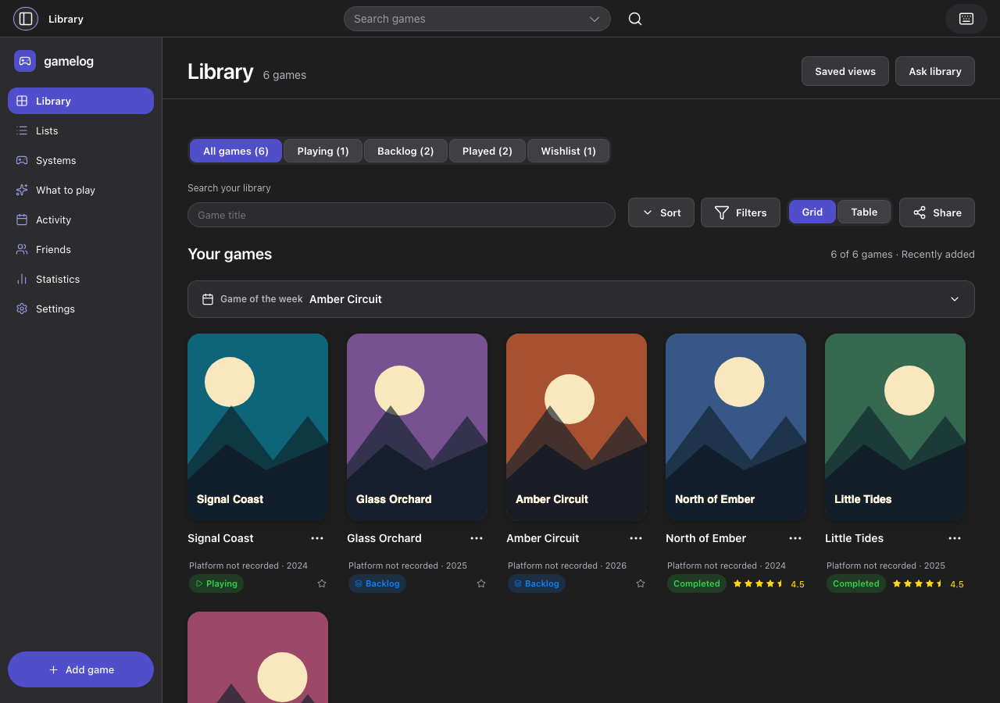
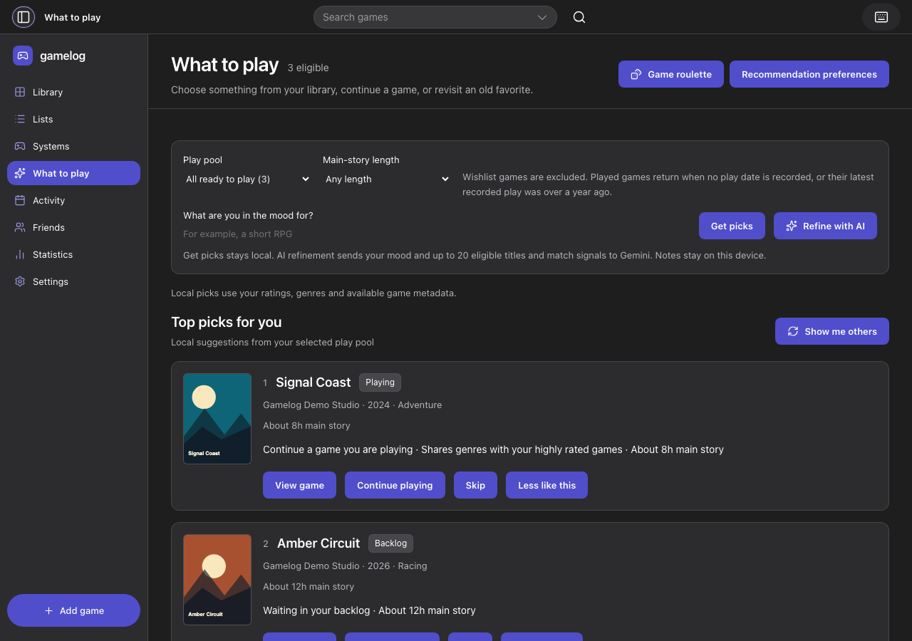
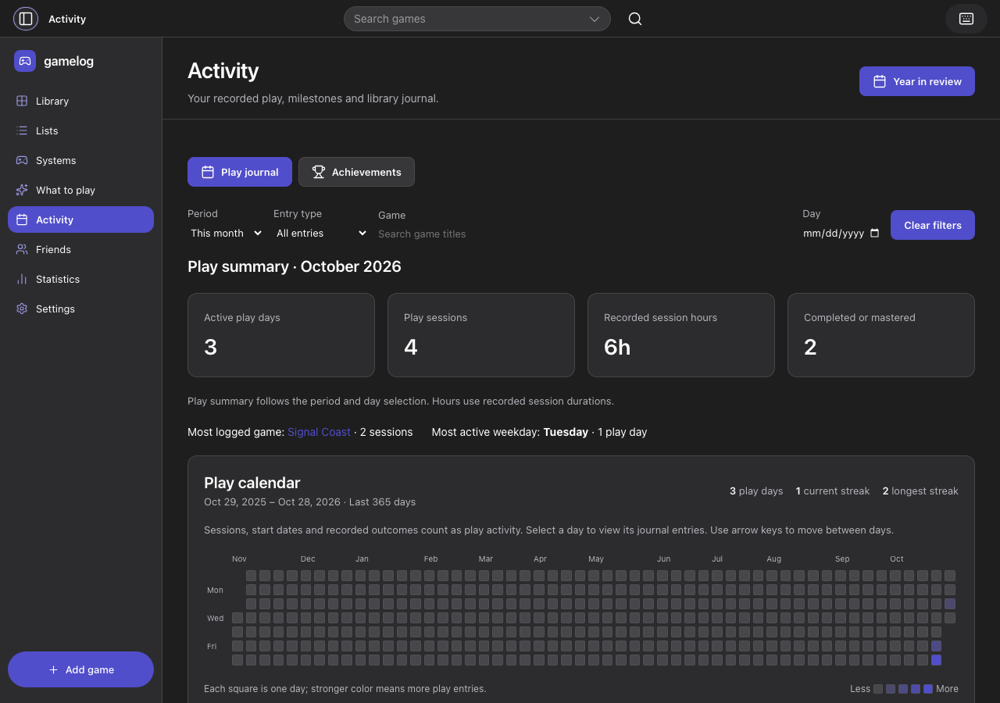
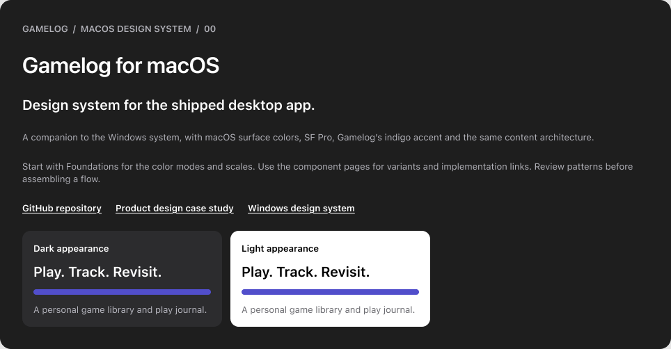

# Gamelog for macOS

[](https://github.com/ESm000ve/Gamelog-Portfolio/actions/workflows/ci.yml)

**A personal game library, play journal, and guide to what to play next.**

Gamelog connects three jobs in one local-first Apple silicon app. Browse and organize a collection, record what happened during play, and decide what fits the next session. Local recommendations explain their reasons. Optional AI can refine picks or draft a log for review.

**Eric Auzenne · Product design · Interaction design · Design systems · Working app**

[Read the case study](docs/case-study/README.md) · [Explore the macOS design system](docs/case-study/design-system/README.md) · [Try the demo](#try-the-demo) · [Windows edition](https://github.com/ESm000ve/Gamelog-Windows-Portfolio)



_Production browser capture using fictional games, sample artwork, and invented play records._

## Explore the product

| Experience   | Design decision                                                                                                                      |
| ------------ | ------------------------------------------------------------------------------------------------------------------------------------ |
| Library      | Cover view supports recognition. A sortable table, filters, and saved views support comparison.                                      |
| Game logs    | Browsing leaves the collection untouched. A player reviews a draft before saving a new game and its log.                             |
| What to Play | The play pool and time limit narrow the options. Each local pick explains why it surfaced.                                           |
| Activity     | The calendar and summary reflect recorded sessions. Collection activity and play history have separate meanings.                     |
| Mac desktop  | Start and stop a session timer from the Play menu, resume from the Dock, share a list through macOS, and recover from local backups. |

| What to Play                                                                                              | Activity                                                                                        |
| --------------------------------------------------------------------------------------------------------- | ----------------------------------------------------------------------------------------------- |
|  |  |

## Design system

The macOS Figma library covers Light and Dark foundations, component states, keyboard behavior, and product patterns. The public reference includes all ten boards and links the component families to their React and CSS sources.

[](docs/case-study/design-system/README.md)

[Open the Figma library](https://www.figma.com/design/TiuL5F9dS9HemUafC0ZnIM?node-id=2-2) · [Browse the exported boards and source map](docs/case-study/design-system/README.md)

## Try the demo

Use Node.js 24 LTS and npm.

```sh
npm ci
npm run dev:web
```

Open the local URL printed in the terminal. In a fresh browser profile, open **Settings → Backup and restore → Import backup**, choose [`examples/demo-library.json`](examples/demo-library.json), and select **Merge (Add & Update)**. The backup adds six fictional games, play logs, and a curated list. Library views, local recommendations, and backups work without service credentials. For the sample sessions in Activity, choose a date range that includes October 2026.

### Connect your own services

Copy `.env.example` to `.env`, add only the credentials you need, and restart the app.

| Variable                                  | Feature                                                                                                                                                                                   |
| ----------------------------------------- | ----------------------------------------------------------------------------------------------------------------------------------------------------------------------------------------- |
| `IGDB_CLIENT_ID` and `IGDB_CLIENT_SECRET` | Catalog search and online details through [IGDB](https://api-docs.igdb.com/#authentication)                                                                                               |
| `GEMINI_API_KEY`                          | Optional AI assistance through [Google AI Studio](https://aistudio.google.com/apikey). Text generation defaults to `gemini-3.5-flash`, with `GEMINI_TEXT_MODEL` available as an override. |
| `STEAM_WEB_API_KEY`                       | [Steam library import](https://steamcommunity.com/dev/apikey) for profiles with public game details                                                                                       |

Credentials stay on the local server. Keep `.env` private and reserve the `VITE_PUBLIC_` prefix for values safe to expose to the renderer.

## Build and verify

Use `npm run dev` for Electron development or `npm run build:desktop` to build the Apple silicon disk image under `release/macos/`.

[macOS desktop setup](docs/DESKTOP-SETUP.md) · [Architecture and data boundaries](docs/ARCHITECTURE.md) · [GitHub Actions](https://github.com/ESm000ve/Gamelog-Portfolio/actions)

| Command                      | Purpose                                                                         |
| ---------------------------- | ------------------------------------------------------------------------------- |
| `npm run check`              | Type-check, lint, and run regression tests                                      |
| `npm run build`              | Build production assets and smoke-check the compiled desktop server and preload |
| `npm run test:ui:production` | Run the browser suite against production assets                                 |
| `npm run test:desktop`       | Check a built Electron app using a temporary profile                            |

[Reproduce the portfolio screenshots](docs/case-study/README.md#reproduce-the-screenshots)
