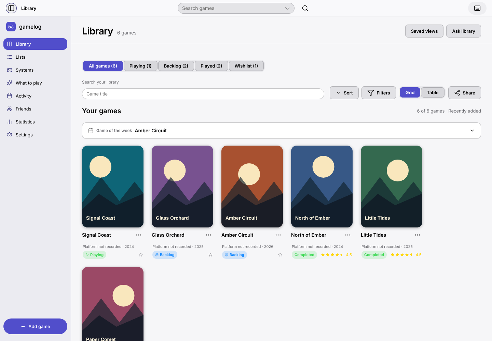
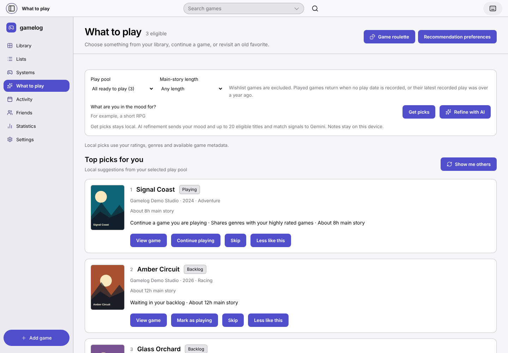
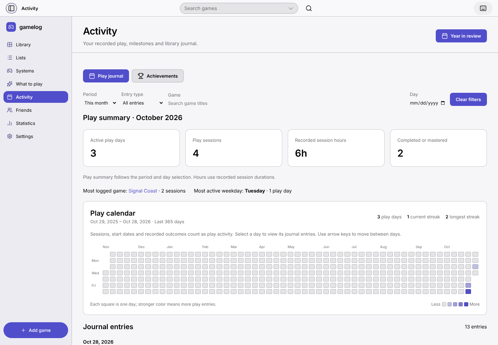

# Gamelog for macOS | A library that helps you choose what to play

**Eric Auzenne · Personal product design project · Apple silicon desktop**

I designed and built Gamelog with AI-assisted implementation. My work covered information architecture, interaction and visual design, the shared UI, the macOS design system, and verification. The product brings together three jobs that often sit in separate tools: organizing games, keeping a play journal, and choosing a next session.

[Try the fictional demo](../README.md#try-the-demo) · [Explore the design system](design-system/README.md)

## The design premise

A large backlog can tell you what you own while leaving the next choice open. I designed around a more concrete question: what fits the time I have and the games I’m already playing? The product uses collection status, play history, and duration estimates to support that decision. This was a design premise evaluated through the working app and regression scenarios.

## 1. Let people browse before committing

In the prototype, **Add to library & log** wrote a backlog entry before opening the editor. A player who closed the editor after looking at the form had already changed the collection.

I moved the save to the end. Browsing opens catalog details. Opening the log creates a draft. **Save** commits the game and the reviewed log together. **Cancel** and **Escape** dismiss the draft and leave the collection intact. The extra review step gives players a clear point of commitment, including when a quick log starts with AI-generated fields.

I verified this with an empty library. The browser scenarios browse, open and dismiss the editor, then check storage directly. Separate Save scenarios verify both records persist. The keyboard check also verifies focus enters the editor and returns to the launch button. [Browser scenarios](../tests/browser/browse-without-saving.spec.ts)

## 2. Support visual browsing and structured comparison



The cover grid supports recognition. The table puts time, ratings, and status into comparable columns. Status tabs give a fast first cut, while filters and saved views let players return to a narrower collection without adding permanent navigation.

**Played** describes a game’s place in the collection. **Completed**, **Abandoned**, and **Shelved** describe outcomes. Separating the fields lets a game stay in Played even when the player chose to stop early. Maintaining both grid and table adds interaction states, so the two views share the same records and filter logic. [Library screen](../src/screens/Library/LibraryScreen.tsx) · [Status and outcome colors](../src/components/ui/statusColors.ts)

## 3. Give each recommendation a reason



What to Play starts with the local library. Players select a pool and an estimated duration limit. A result explains the signals that surfaced it, such as time to finish, an unfinished game, or genre overlap. Actions to open, start, or skip a game stay separate.

Local ranking has limited context about a player’s mood. The app offers optional AI refinement while keeping the underlying constraints visible. Quick logs stay reviewable, and resume recaps request consent to send selected excerpts. [Recommendation screen](../src/screens/Recommend/RecommendScreen.tsx)

## 4. Make play history useful on the Mac



Adding a title and actually playing it are separate events. Activity uses recorded sessions and supports reviewing a specific period. The Mac Play menu can start or stop a timer without asking players to leave their current workflow. When stopped, the timer records a session for the selected game. The Dock adds shortcuts back into common tasks, and the system share picker handles list sharing.

An accurate calendar can look sparse when little has been logged. I kept the missing history visible and made recording it easier. Backups and recoverable removals give players a path back from mistakes. [Activity screen](../src/screens/Activity/ActivityScreen.tsx) · [Mac menu](../electron/macMenu.ts) · [Desktop services](../electron/desktopFeatures.ts)

## System and implementation

The Mac library follows the organization of my Windows system so a reviewer can find the same component families and product patterns. The Mac implementation uses its own window and sidebar surfaces, SF Pro typography, and app-specific control states. The design-system reference shows how those decisions become semantic variables, component states, and source links.

[macOS design-system boards and source map](design-system/README.md)

The [editable Figma design system](https://www.figma.com/design/TiuL5F9dS9HemUafC0ZnIM?node-id=2-2) includes component states and Light/Dark foundations. Explore the [portfolio board](https://www.figma.com/design/TiuL5F9dS9HemUafC0ZnIM?node-id=2-687) or the [exported boards and offline viewer](design-system/README.md) in this repository. The prototype [information architecture](information-architecture/ia.html) and [sitemap](information-architecture/sitemap.html) are kept alongside them.

## Evidence and next validation

The working app, production browser screenshots, storage checks, and desktop build checks establish what shipped. The portfolio uses fictional data. Participant research and adoption metrics are outside this project’s evidence.

For a moderated study, I would ask participants to find a game they own, record a session, choose a game within a time limit, and recover a removal. I would observe whether they can complete each task, where they hesitate, and whether they can explain what changes their library. [Current verification record](VERIFICATION.md) · [Project checks](https://github.com/ESm000ve/Gamelog-Portfolio/actions)

## Reproduce the screenshots

Every image in [`screenshots/`](screenshots/) comes from the production browser build, the fictional [demo library](../examples/demo-library.json), a fixed date and mocked provider requests.

```sh
npx playwright install chromium
npm run screenshots
```

The command builds the web app and rewrites the six PNGs in `docs/screenshots/`. The browser suite also keeps a separate [capture scenario](../tests/browser/portfolio-screenshots.spec.ts); GitHub Actions uploads its output as the **portfolio-screenshots** artifact.
