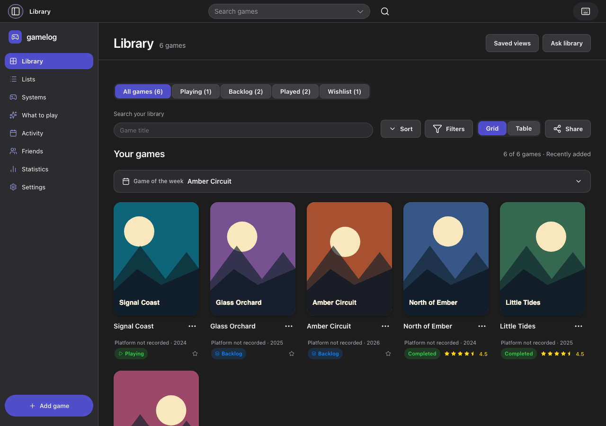
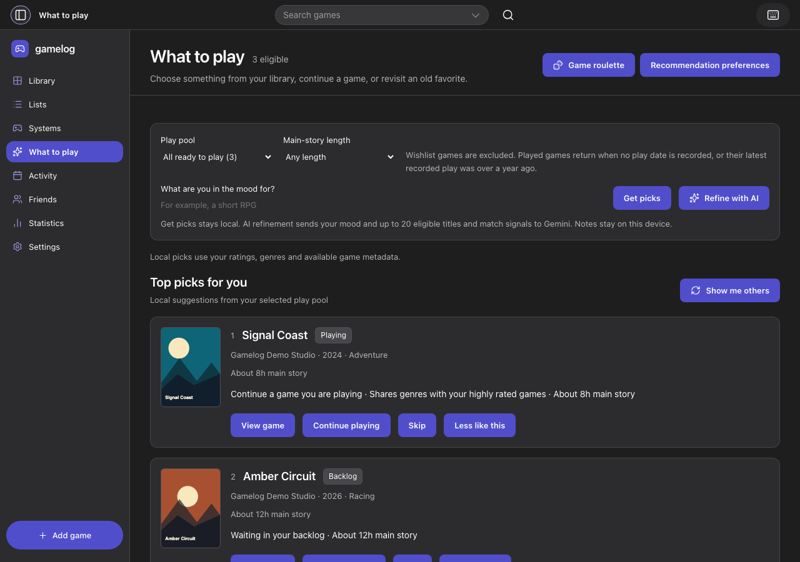
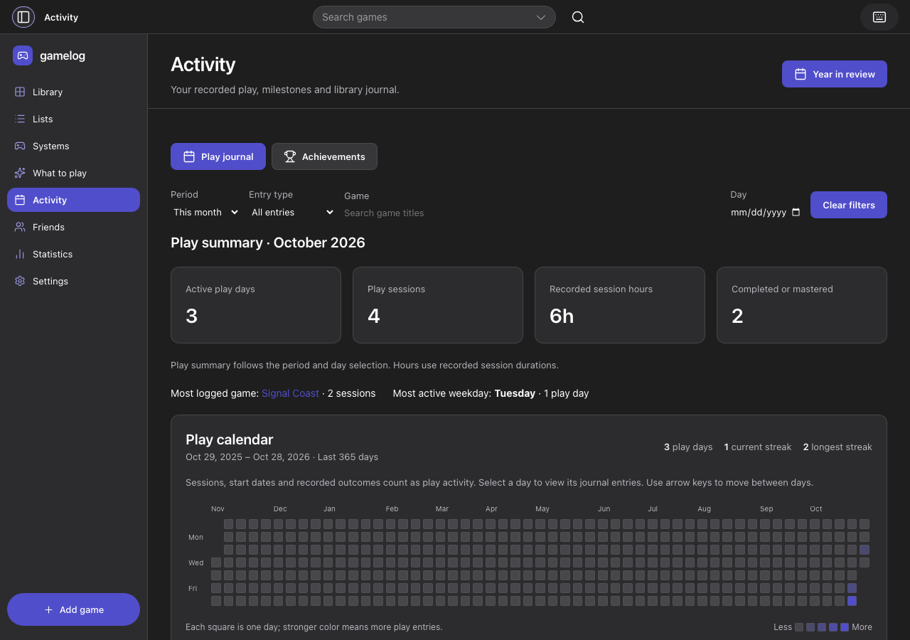

# Gamelog portfolio notes

Gamelog is an end-to-end product design and implementation project. It brings game discovery, collection management, and a play journal into one interface. The recurring decision it supports is what to play next, using the collection and play history someone already maintains.

## Design decisions

**Separate library status from play outcome.** A game can be in the Played group while its last playthrough was completed, abandoned, or shelved. Keeping those fields separate lets people filter the library by intent while preserving the history of what happened.

**Use the same collection for browsing and comparing.** Cover view supports visual scanning. Table view puts sortable information such as time and rating next to each title. Search, filters, and saved views help people return to the same slice of their library.

**Make the choice of what to play visible.** The recommendation screen exposes the play pool and time constraint, and gives reasons for suggested games. Players can continue a current game, select from the backlog, or revisit a favorite. Optional AI can refine eligible choices.

**Keep assistance reviewable.** A quick log enters the editor as a draft. Resume recaps ask players to choose the exact notes to share. Play history and exports live on the device, and local recommendations remain available without a Gemini key.

Earlier design artifacts document the prototype’s structure and navigation review. [Information architecture](ia.html) · [Sitemap](sitemap.html)

## Screenshots

### Library



### What to Play



### Activity



## Capture the three core flows

The screenshot spec uses fictional game records in a fresh Playwright profile. It imports them through the app’s normal backup flow and captures the browser version with mocked service responses.

```sh
npx playwright install chromium
npm run test:ui:production -- portfolio-screenshots.spec.ts
```

The PNGs appear under `test-results/`. GitHub Actions also collects them as the **portfolio-screenshots** artifact after the browser suite passes.

| Screenshot            | Portfolio caption                                                                                      |
| --------------------- | ------------------------------------------------------------------------------------------------------ |
| `01-library.png`      | The collection groups games by play status and supports both cover browsing and structured comparison. |
| `02-what-to-play.png` | Players narrow the pool by available time and see why a game is suggested.                             |
| `03-activity.png`     | The journal connects play sessions and completed games to a calendar and summary.                      |
