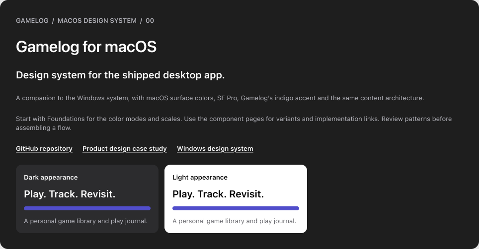
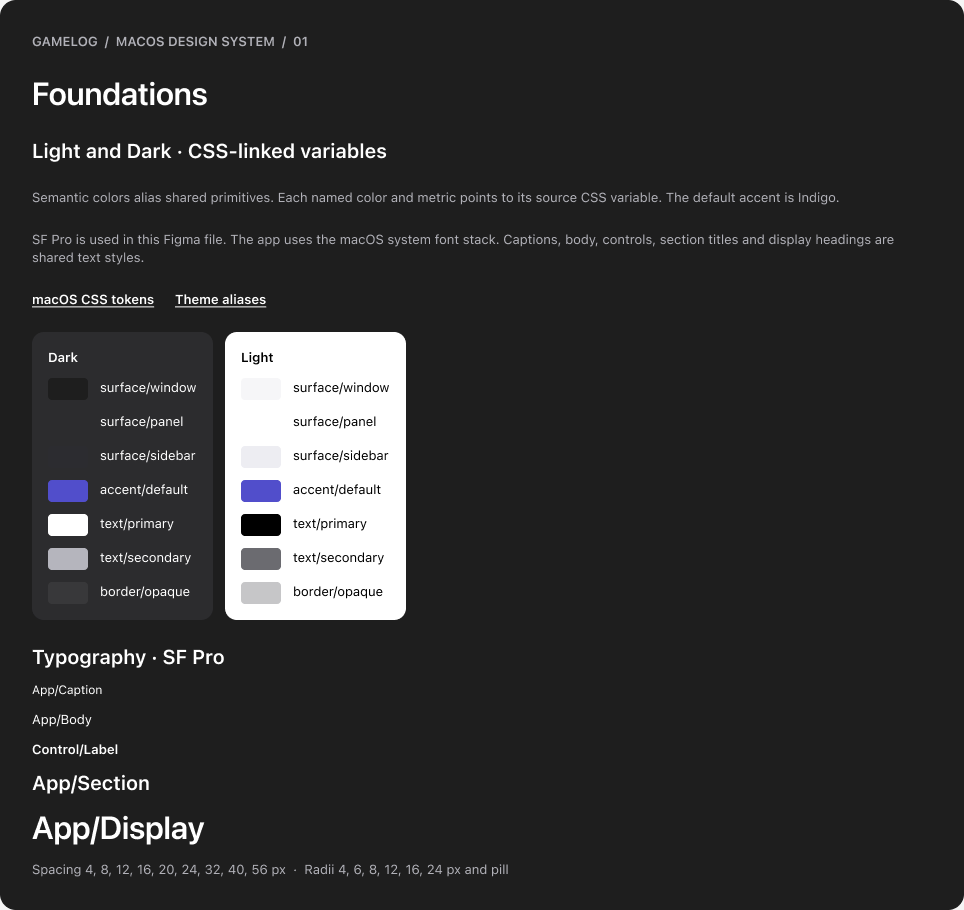
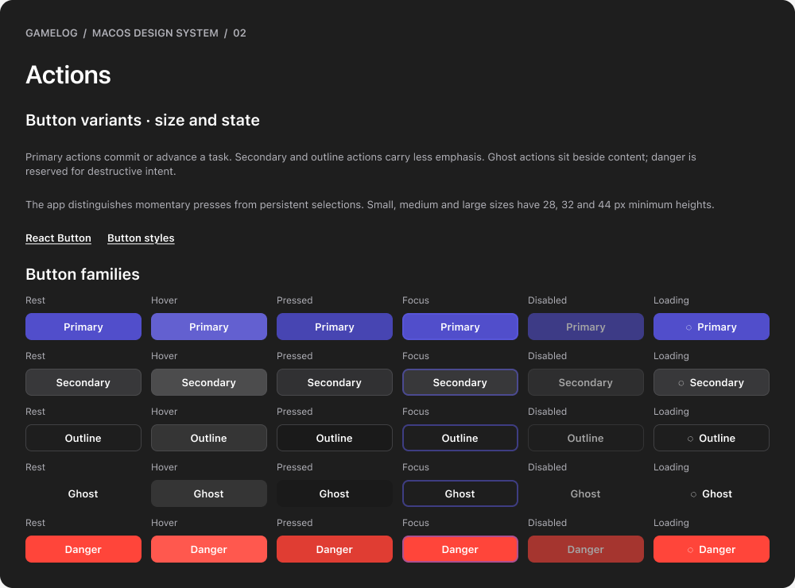

# Gamelog for macOS | Design system

[**Open the editable Figma library**](https://www.figma.com/design/TiuL5F9dS9HemUafC0ZnIM?node-id=2-2) · [Product design case study](../README.md) · [Windows companion](https://github.com/ESm000ve/Gamelog-Windows-Portfolio/tree/main/docs/design-system)

The macOS library documents the interface of the working app. It follows the Windows library’s ten-page structure so foundations, component states, patterns, and handoff are easy to find across platforms. The Mac implementation uses window and sidebar surfaces specific to the app, SF Pro typography, and the indigo accent used by default. The Figma library is editable. The exports below are static references for review.

## What the system covers

- **Foundations.** Light and Dark semantic colors, alias relationships, typography, spacing, radii, and elevation. Semantic variables carry their matching CSS custom property names.
- **Controls.** Primary, Secondary, Outline, Ghost, and Danger buttons across three sizes and six states. The library also shows search, grid and table selection, and sidebar states.
- **Content and feedback.** Cover cards, collection statuses, play outcomes, the draft editor, and progress, success, and failure examples.
- **Product patterns.** Browse, review, save or dismiss, and return focus. Portfolio boards connect the component work to Library, What to Play, and Activity.

## Board gallery

| Board                        | What to look for                                    | Preview                                                                                                |
| ---------------------------- | --------------------------------------------------- | ------------------------------------------------------------------------------------------------------ |
| Start here                   | Mac scope and review entry points                   | [PNG](start-here.png) · [Figma](https://www.figma.com/design/TiuL5F9dS9HemUafC0ZnIM?node-id=2-2)       |
| Foundations                  | Semantic Light/Dark colors and shared SF Pro styles | [PNG](foundations.png) · [Figma](https://www.figma.com/design/TiuL5F9dS9HemUafC0ZnIM?node-id=2-23)     |
| Actions                      | Rest, hover, pressed, focus, disabled, and loading  | [PNG](actions.png) · [Figma](https://www.figma.com/design/TiuL5F9dS9HemUafC0ZnIM?node-id=2-87)         |
| Inputs and selection         | Search states and persistent grid/table selection   | [PNG](inputs.png) · [Figma](https://www.figma.com/design/TiuL5F9dS9HemUafC0ZnIM?node-id=2-448)         |
| Navigation                   | Sidebar destination states                          | [PNG](navigation.png) · [Figma](https://www.figma.com/design/TiuL5F9dS9HemUafC0ZnIM?node-id=2-511)     |
| Content and status           | Collection status, play outcome, and cover metadata | [PNG](content-status.png) · [Figma](https://www.figma.com/design/TiuL5F9dS9HemUafC0ZnIM?node-id=2-548) |
| Overlays and feedback        | Draft editor and operation messages                 | [PNG](overlays.png) · [Figma](https://www.figma.com/design/TiuL5F9dS9HemUafC0ZnIM?node-id=2-608)       |
| UX patterns                  | Browse, review, and save or dismiss                 | [PNG](ux-patterns.png) · [Figma](https://www.figma.com/design/TiuL5F9dS9HemUafC0ZnIM?node-id=2-649)    |
| Accessibility and governance | Keyboard, semantics, and implementation review      | [PNG](accessibility.png) · [Figma](https://www.figma.com/design/TiuL5F9dS9HemUafC0ZnIM?node-id=2-668)  |
| Portfolio                    | The three core product flows                        | [PNG](portfolio.png) · [Figma](https://www.figma.com/design/TiuL5F9dS9HemUafC0ZnIM?node-id=2-687)      |

The PNGs can also be opened locally after downloading the repository.

## Design decisions and code

| Decision                                     | How it works in the app                                                                                                                                                                                        | Source                                                                                                                                                                        |
| -------------------------------------------- | -------------------------------------------------------------------------------------------------------------------------------------------------------------------------------------------------------------- | ----------------------------------------------------------------------------------------------------------------------------------------------------------------------------- |
| Give surfaces semantic roles                 | Window, panel, toolbar, text, separator, and control roles change with appearance. This lets a component keep the same purpose in both modes. The specimens use Indigo, and the app offers additional accents. | [Mac tokens](../../../src/styles/platforms/macos.css) · [Theme aliases](../../../src/styles/theme.css)                                                                        |
| Separate action from selection               | A button’s transient press is distinct from a persistent view choice. Loading and disabled states explain when an action is unavailable.                                                                       | [Button](../../../src/components/ui/Button.tsx) · [Button styles](../../../src/components/ui/Button.css) · [Library controls](../../../src/screens/Library/LibraryScreen.tsx) |
| Give navigation a visible current state      | The sidebar identifies the current destination with a persistent tint. A visible label communicates the destination alongside its icon.                                                                        | [Sidebar](../../../src/shell/Sidebar.tsx) · [Sidebar styles](../../../src/shell/Sidebar.css)                                                                                  |
| Separate collection status from play outcome | A Played game can have a Completed, Abandoned, or Shelved outcome. The cover card pairs colored treatments with text.                                                                                          | [Cover card](../../../src/components/CoverCard/index.tsx) · [Status colors](../../../src/components/ui/statusColors.ts)                                                       |
| Keep draft and committed states distinct     | The log dialog enters keyboard focus on open. Save writes the reviewed records. Cancel and Escape leave the library intact, and focus returns to the trigger.                                                  | [Modal](../../../src/components/ui/Modal.tsx) · [Focus behavior](../../../src/hooks/useFocusTrap.ts) · [Draft tests](../../../tests/browser/browse-without-saving.spec.ts)    |
| Make operation results visible               | Progress, success, and failure are handled through shared feedback. The product also uses recovery and undo for supported changes.                                                                             | [Operation feedback](../../../src/components/ui/Feedback.tsx) · [Recovery settings](../../../src/screens/Settings/RecoverySettings.tsx)                                       |

| Light and Dark foundations                                        | Action variants                                                       |
| ----------------------------------------------------------------- | --------------------------------------------------------------------- |
|  |  |

## Review and handoff

Use the CSS and React source for exact runtime values and behavior. When a component changes, update the matching Figma specimen and check the affected Light and Dark surfaces. Verify keyboard focus, labels, dismissal, and feedback against the working app. The [browser suite](../../../tests/browser/) covers implemented behavior. Broader assistive technology and contrast validation are separate review tasks.

Use the [demo library](../../../examples/demo-library.json) with the app to explore the working interactions behind the static boards.
