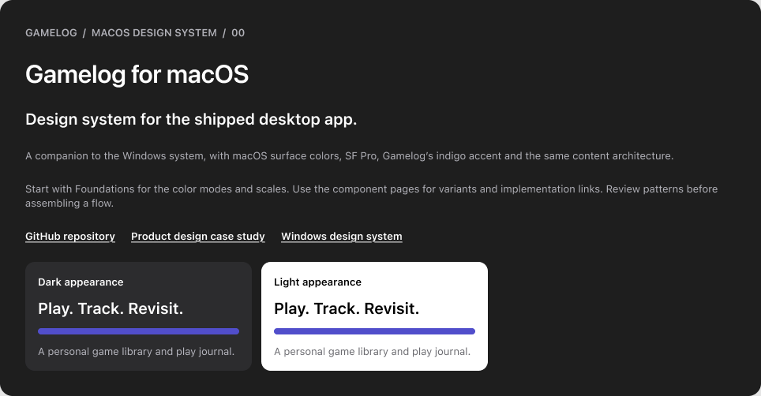
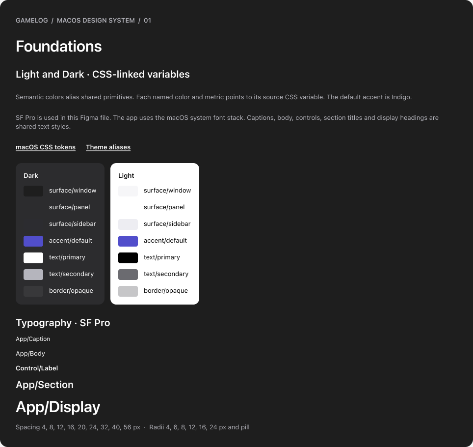
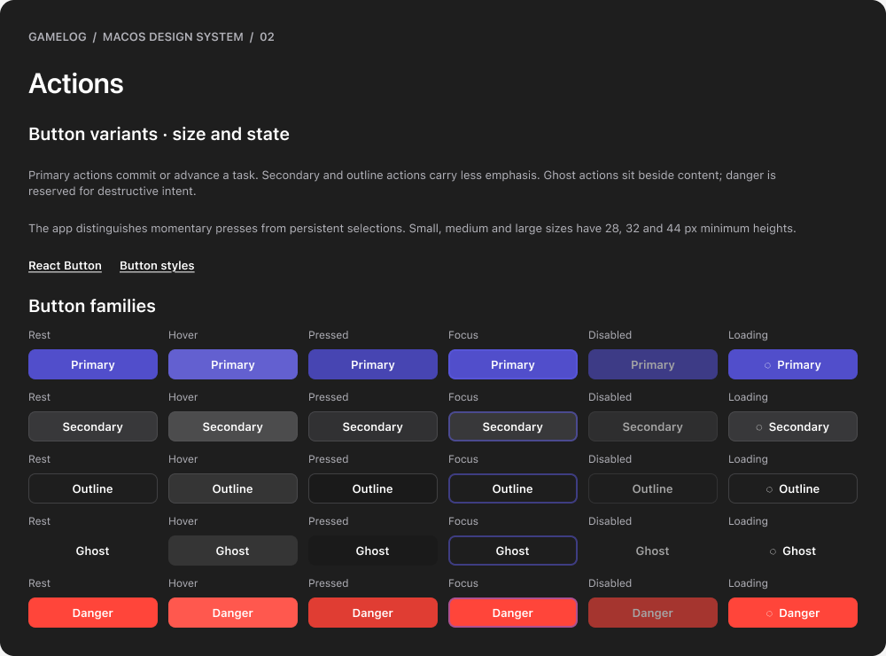
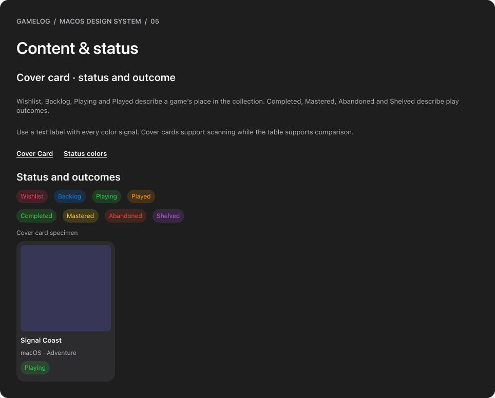
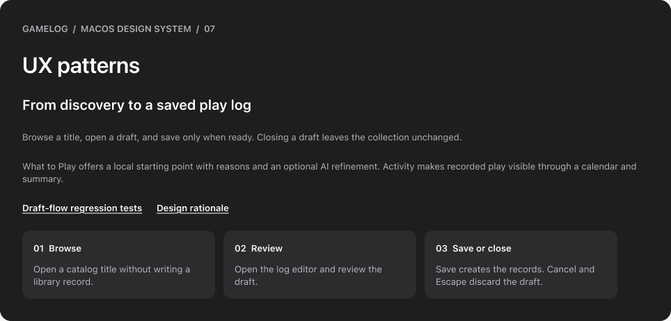
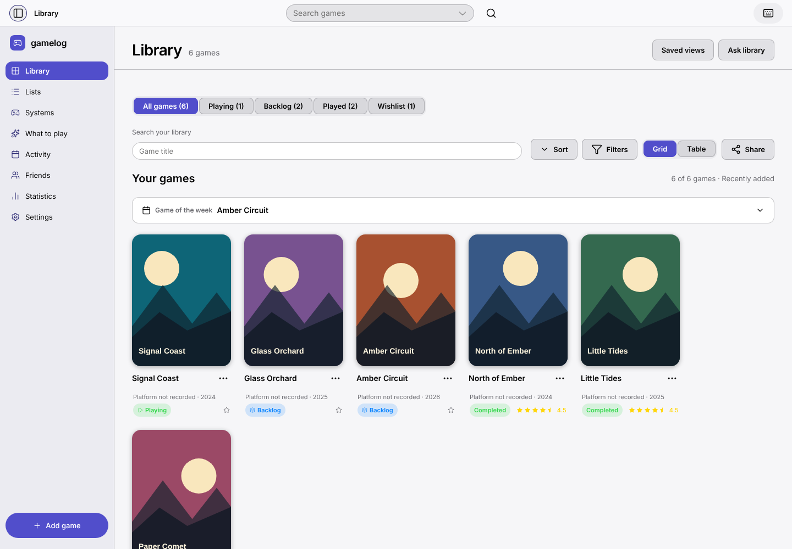
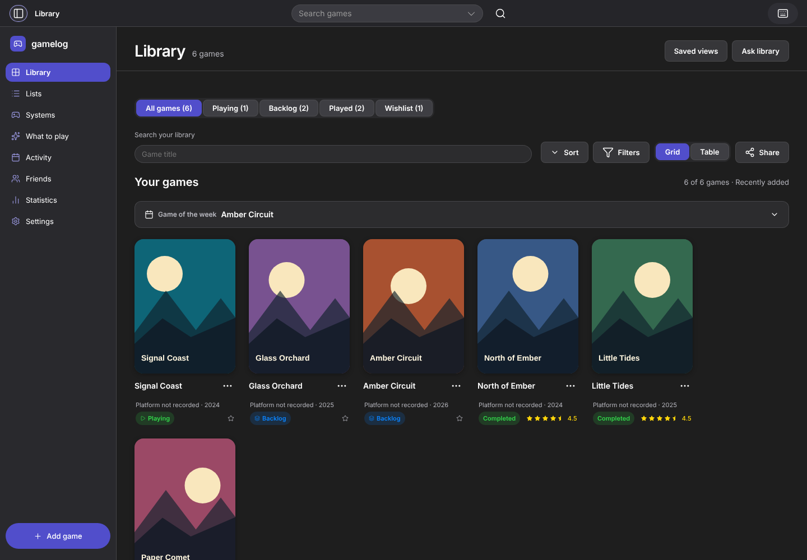

# Gamelog macOS design system

[**Open the editable Figma design system →**](https://www.figma.com/design/TiuL5F9dS9HemUafC0ZnIM?node-id=2-2)

[Portfolio board](https://www.figma.com/design/TiuL5F9dS9HemUafC0ZnIM?node-id=2-687) · [Offline viewer](preview/README.md) · [File and node manifest](figma-manifest.json) · [Handoff notes](preview/FIGMA-HANDOFF.md) · [Windows companion](https://github.com/ESm000ve/Gamelog-Windows-Portfolio/tree/main/docs/design-system)

The macOS experience uses window and sidebar surfaces specific to the app, SF Pro typography, and the indigo accent used by default, with project-specific semantic tokens, interaction patterns and page composition. The source is the authority for the functioning app.



## What is included

The Figma snapshot contains 10 pages, 105 variables in three collections (primitives, semantic color with Dark/Light modes, and metrics), five text styles, four elevation styles and 115 component masters across 10 component sets and two standalone components. The library is editable in Figma; it is a review library, not a published team library. It follows the Windows library's ten-page structure so reviewers can find the same foundations, components and patterns on both platforms.

This repository includes the exported references so reviewers can explore the system without opening Figma:

- **10 presentation boards:** overview, foundations, actions, inputs, navigation, content/status, overlays, UX patterns, accessibility/governance and portfolio.
- **CSS and JSON tokens:** source-derived snapshots of the Light and Dark modes and the eight accent colors.
- **Handoff notes and a manifest:** file/node links, scope, fonts and representation limits.
- **An offline viewer:** search, step through and download the boards without Figma.

The editable components and variables remain in the [Figma file](https://www.figma.com/design/TiuL5F9dS9HemUafC0ZnIM?node-id=2-2). These PNGs and the viewer are reference exports; a native `.fig` file is not included. Figma access follows the file owner's sharing settings. Unlike the Windows library, this one does not yet include a Figma prototype.

## Board gallery

| Board | What to look for | Preview |
| --- | --- | --- |
| Start here | Scope, Light and Dark appearance | [PNG](preview/boards/00-cover.png) · [Figma](https://www.figma.com/design/TiuL5F9dS9HemUafC0ZnIM?node-id=2-2) |
| Foundations | Semantic Light/Dark colors and shared SF Pro styles | [PNG](preview/boards/01-foundations.png) · [Figma](https://www.figma.com/design/TiuL5F9dS9HemUafC0ZnIM?node-id=2-23) |
| Actions | Rest, hover, pressed, focus, disabled and loading | [PNG](preview/boards/02-actions.png) · [Figma](https://www.figma.com/design/TiuL5F9dS9HemUafC0ZnIM?node-id=2-87) |
| Inputs and selection | Search states and persistent grid/table selection | [PNG](preview/boards/03-inputs.png) · [Figma](https://www.figma.com/design/TiuL5F9dS9HemUafC0ZnIM?node-id=2-448) |
| Navigation | Sidebar destination states | [PNG](preview/boards/04-navigation.png) · [Figma](https://www.figma.com/design/TiuL5F9dS9HemUafC0ZnIM?node-id=2-511) |
| Content and status | Collection status, play outcome and cover metadata | [PNG](preview/boards/05-content.png) · [Figma](https://www.figma.com/design/TiuL5F9dS9HemUafC0ZnIM?node-id=2-548) |
| Overlays and feedback | Draft editor and operation messages | [PNG](preview/boards/06-overlays.png) · [Figma](https://www.figma.com/design/TiuL5F9dS9HemUafC0ZnIM?node-id=2-608) |
| UX patterns | Browse, review, and save or dismiss | [PNG](preview/boards/07-patterns.png) · [Figma](https://www.figma.com/design/TiuL5F9dS9HemUafC0ZnIM?node-id=2-649) |
| Accessibility and governance | Keyboard, semantics and implementation review | [PNG](preview/boards/08-accessibility.png) · [Figma](https://www.figma.com/design/TiuL5F9dS9HemUafC0ZnIM?node-id=2-668) |
| Portfolio | The three core product flows | [PNG](preview/boards/09-portfolio.png) · [Figma](https://www.figma.com/design/TiuL5F9dS9HemUafC0ZnIM?node-id=2-687) |

## Selected boards

| Foundations | Actions and interaction states |
| --- | --- |
| [](preview/boards/01-foundations.png) | [](preview/boards/02-actions.png) |

| Status and cover metadata | Product patterns |
| --- | --- |
| [](preview/boards/05-content.png) | [](preview/boards/07-patterns.png) |

## Explore locally

After downloading or cloning the repository, open [`preview/index.html`](preview/index.html) in your browser. Keep its surrounding files and folders together. GitHub displays the HTML source; download it to use the interactive viewer.

Alternatively, from the project root:

```sh
node docs/design-system/serve-preview.mjs
```

Open `http://127.0.0.1:5192`. The viewer supports board search, previous/next navigation, actual-size display and PNG downloads. It needs no API keys.

## Design-to-code source map

| Foundation or pattern | Source |
| --- | --- |
| Semantic colors, Light/Dark and accents | [`src/styles/platforms/macos.css`](../../src/styles/platforms/macos.css), [`src/styles/theme.css`](../../src/styles/theme.css) |
| Typography, spacing and global layout | [`src/styles/globals.css`](../../src/styles/globals.css) |
| Window and sidebar surfaces | [`src/shell/Sidebar.tsx`](../../src/shell/Sidebar.tsx), [`Sidebar.css`](../../src/shell/Sidebar.css) |
| Actions and form controls | [`src/components/ui/Button.tsx`](../../src/components/ui/Button.tsx), `Controls.tsx` |
| Dialogs and focus handling | [`Modal.tsx`](../../src/components/ui/Modal.tsx), [`useFocusTrap.ts`](../../src/hooks/useFocusTrap.ts) |
| Pending, success, failure and undo | [`Feedback.tsx`](../../src/components/ui/Feedback.tsx), [`RecoverySettings.tsx`](../../src/screens/Settings/RecoverySettings.tsx) |
| Cover metadata and status taxonomy | [`src/components/CoverCard/`](../../src/components/CoverCard/), [`statusColors.ts`](../../src/components/ui/statusColors.ts) |
| Overlay coordination | [`src/services/overlay.ts`](../../src/services/overlay.ts) |

The [CSS](tokens/macos.tokens.css) and [JSON](tokens/macos.tokens.json) snapshots provide portable references. They are documentation snapshots, not automatically synchronized exports. Check current source before implementing changes.

## Interaction principles

- Keep preview and saved records distinct; saving is an explicit commitment.
- Preserve personal records when catalog metadata changes.
- Give pending work a visible state and make failures recoverable.
- Return keyboard focus when dialogs close; use native control semantics.
- Use text and shape alongside color for status and selection.
- Offer clear empty states, cancellation and undo where supported.
- Keep optional AI actions explicit and reviewable, alongside local alternatives.





The app uses the macOS system font stack, which resolves to SF Pro on a Mac. No font binaries are redistributed. The screenshots above were captured in headless Chromium on Linux, which substitutes a different sans-serif. Keyboard checks do not replace a complete accessibility review across assistive technologies, contrast states and zoom levels. Use the [demo library](../../examples/demo-library.json) with the app to explore the working interactions behind the static boards.
